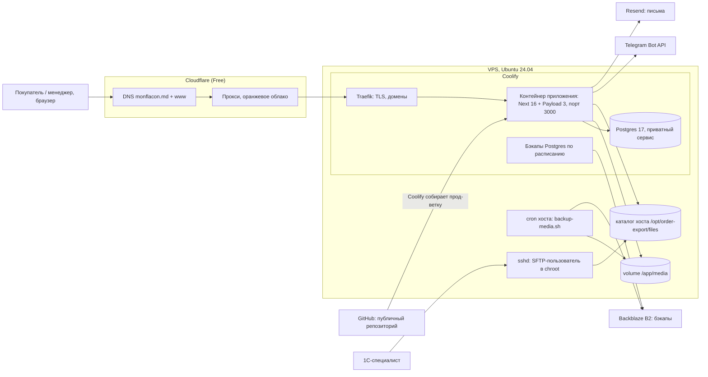

# 01. Архитектура

- **Для кого:** новый разработчик; технический администратор.
- **Что здесь:** стек и версии, схема компонентов, внешние сервисы, дерево `src/` с назначением папок, границы между витриной Next, Payload и своим кодом.

---

## 1. Стек и версии

Из `package.json` (точные версии — там, где закреплены; `^` — минимальная версия диапазона):

| Слой | Пакет | Версия |
|---|---|---|
| Фреймворк | `next` | 16.2.6 (App Router, Turbopack в dev, `output: 'standalone'`) |
| CMS / админка / API | `payload`, `@payloadcms/next`, `@payloadcms/ui`, `@payloadcms/db-postgres`, `@payloadcms/richtext-lexical`, `@payloadcms/translations` | 3.87.0 |
| UI | `react`, `react-dom` | 19.2.6 |
| Язык | `typescript` | 5.7.3 (strict) |
| Стили | `tailwindcss`, `@tailwindcss/postcss` | ^4.3.3; токены — `src/styles/tokens.css`; `shadcn` ^4.16.1, `tailwind-merge` ^3.6.0 |
| i18n витрины | `next-intl` | ^4.13.4 (локали `ro`/`ru`/`en`, префикс всегда) |
| URL-состояние фильтров | `nuqs` | ^2.9.4 |
| Состояние корзины | `zustand` | ^5.0.14 (persist в localStorage) |
| Валидация | `zod` | ^4.4.3 |
| Изображения | `sharp` | 0.34.2 |
| PDF | `pdf-lib` ^1.17.1, `@pdf-lib/fontkit` ^1.1.1 | |
| ZIP | `adm-zip` | ^0.6.0 |
| Скрипты | `tsx` | 4.22.4 |
| Тесты | `vitest` 4.0.18 (+ jsdom), `@playwright/test` 1.58.2 | |
| Рантайм | Node 22 (`node:22-bookworm-slim` в Dockerfile), менеджер пакетов `pnpm` (engines: 9–11) | |
| БД | PostgreSQL 17 (`postgres:17-alpine` в `docker-compose.dev.yml`; на проде — Postgres 17 в Coolify) | |

Внешних SDK нет: Telegram и Resend вызываются обычным `fetch` к их HTTP API.

---

## 2. Компоненты и связи



Всё, что вне контейнера приложения (Cloudflare, Coolify, Traefik, Postgres-сервис, бэкапы, cron, SFTP, B2), настраивается вне репозитория — см. [08-infrastructure.md](08-infrastructure.md).

Одно приложение — один контейнер: Next отдаёт и витрину, и админку Payload, и API. Отдельного бэкенда, очередей, Redis, CDN для картинок нет. Медиа хранятся на диске (volume `/app/media`), не в S3.

---

## 3. Границы ответственности

| Слой | Что делает | Где |
|---|---|---|
| **Витрина (Next, App Router)** | страницы для покупателей на трёх языках, корзина, форма заявки, свои API-роуты витрины | `src/app/(frontend)/`, `src/components/`, `src/lib/` |
| **Payload (админка + REST/GraphQL)** | `/admin`, коллекции и глобалы, авторизация, загрузка файлов, REST `/api/<collection>`, GraphQL | `src/app/(payload)/` (сгенерированные файлы шаблона), `src/payload.config.ts`, `src/collections/`, `src/globals/` |
| **Payload Local API** | доступ к данным из кода витрины и route handlers **без HTTP**, напрямую в БД; по умолчанию без проверки прав (`overrideAccess`) | `getPayloadClient()` в `src/lib/payload.ts` |
| **Свой код поверх Payload** | кастомные эндпоинты импорта/кампаний, кастомные экраны и ячейки админки, хуки денормализации и сброса кэша | `src/endpoints/`, `src/components/admin/`, хуки в `src/collections/*.ts` |
| **Мидлварь** | заглушка «сайт в разработке» + локали | `src/proxy.ts`, `src/lib/maintenance.ts` |
| **Заглушка** | отдельная группа маршрутов без обращения к БД | `src/app/(maintenance)/` |

Принципы, заложенные в код:
- витрина читает данные через Local API, а не через HTTP к своему же REST;
- серверные компоненты по умолчанию, `'use client'` — точечно;
- бизнес-логика — в `src/lib/`, компоненты «тупые»;
- цены только в MDL; денормализованные поля товара (`minPrice`, `maxPrice`, `inStock` и т.д.) пишутся только хуком;
- все цвета/радиусы/шрифты — токены `src/styles/tokens.css`;
- новая строка интерфейса — сразу во все три `messages/*.json`.

Почему один процесс, а не отдельные фронт и бэк: проект небольшой (бутик, сотни SKU), Payload 3 встраивается в Next, и хуки коллекций могут сбрасывать кэш витрины напрямую, без вебхуков. Цена этого решения — всё, что запускается **отдельным процессом** (CLI-импорт, сид, миграции), до кэша работающего сайта не достаёт (см. [05](05-catalog-and-content.md#кэш-витрины)).

---

## 4. Дерево `src/`

```
src/
├── access/roles.ts          роли admin/manager и функции доступа
├── app/
│   ├── (frontend)/          витрина
│   │   ├── [locale]/        все страницы с префиксом локали (каталог, товар, корзина, заказ, страницы)
│   │   ├── api/             API витрины: order-request, order-status, cart-revalidate,
│   │   │                    promo-code-check, promo-popup, search/suggest
│   │   └── sitemap.ts       /sitemap.xml
│   ├── (maintenance)/       заглушка «сайт в разработке», без БД
│   ├── (payload)/           админка и REST/GraphQL Payload (файлы шаблона + custom.scss)
│   ├── icon.tsx             favicon (/icon)
│   └── robots.ts            /robots.txt
├── collections/             11 коллекций Payload (схема, доступ, хуки)
├── components/
│   ├── admin/               кастомные экраны, кнопки, ячейки админки
│   ├── analytics/           GA4 + баннер согласия (включается переменной NEXT_PUBLIC_GA_ID)
│   ├── brand/, brands/      знак MON FLACON, страница брендов
│   ├── cart/                корзина, форма заявки, промокод
│   ├── catalog/             каталог, фильтры, карточка товара
│   ├── forms/               общее поле телефона
│   ├── giftItems/           подарочные сертификаты и Gift box
│   ├── home/                карусель баннеров, ленты, бренд-строка
│   ├── layout/              шапка, футер, поиск, переключатель языка, промо-полоса
│   ├── maintenance/         части заглушки
│   ├── pages/               рендер страниц из коллекции Pages
│   ├── product/             галерея, выбор объёма, кнопка покупки
│   ├── promo/               попап «первая скидка»
│   ├── seo/                 JSON-LD
│   └── ui/                  базовые компоненты shadcn
├── endpoints/               кастомные эндпоинты Payload: импорт CSV/ZIP/нот, сброс кэша, кампании
├── fields/                  переиспользуемые поля: slug, seo, internalLink
├── globals/                 4 глобала: homepage, settings, navigation, promo-popup-settings
├── i18n/                    маршрутизация next-intl, загрузка сообщений
├── lib/
│   ├── admin/               скачивание CSV/PDF в админке
│   ├── analytics/           gtag, согласие
│   ├── campaigns/           запуск/остановка кампаний скидок
│   ├── cart/                стор корзины
│   ├── catalog/             запросы каталога, фасеты, разделы, списки значений
│   ├── content/             глобалы, страницы, баннеры, попап, резолвер локалей
│   ├── giftItems/           запросы подарков
│   ├── import/              движок CSV-импорта
│   ├── orders/              заявка: схема, телефон, промокоды, CSV, PDF, email, Telegram, экспорт, rate-limit
│   ├── products/            денормализация вариантов
│   ├── search/              полнотекстовый поиск на Postgres
│   ├── seed/                демо-данные для pnpm seed
│   ├── seo/                 метаданные, JSON-LD, SITE_URL
│   ├── ui/                  тост корзины
│   ├── cache.ts, revalidate.ts   TTL и единая точка сброса кэша
│   ├── links.ts, pricing.ts, maintenance.ts, payload.ts, slugify.ts, ...
├── migrations/              29 миграций схемы (+ index.ts)
├── styles/tokens.css        дизайн-токены
├── types/                   типы для аналитики
├── payload-types.ts         сгенерированные типы (pnpm generate:types)
├── payload.config.ts        конфигурация Payload
└── proxy.ts                 мидлварь (next-intl + заглушка)
```

Вне `src/`: `messages/{ro,ru,en}.json` — тексты витрины; `scripts/` — CLI-скрипты и проверки ([10](10-tests-and-tools.md)); `tests/` — int и e2e; `docs/` — документация (в Docker-образ не попадает, см. `.dockerignore`); `public/` — статика.

---

## 5. Языки: две независимые системы

- **Витрина** — next-intl, локали `ro` (по умолчанию), `ru`, `en`, префикс в URL всегда (`src/i18n/routing.ts`). Тексты интерфейса — `messages/*.json`.
- **Контент** — локализация полей Payload, те же три локали, `fallback: true` на `ro` (`src/payload.config.ts`).
- **Интерфейс админки** — собственная i18n Payload (`supportedLanguages: en, ro, ru`, по умолчанию `ru`). Подписи полей в конфигах коллекций захардкожены по-русски.
