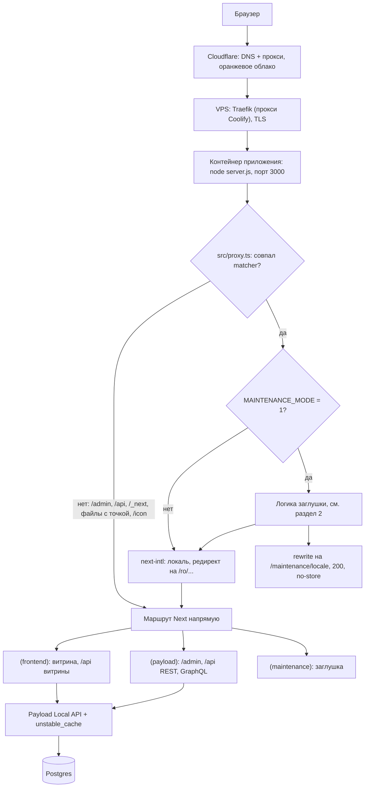

# 02. Путь HTTP-запроса

- **Для кого:** разработчик, который добавляет страницу, чинит 404/редиректы, включает или выключает заглушку «сайт в разработке».
- **Что здесь:** через что проходит запрос от браузера до страницы; порядок логики в `src/proxy.ts`; заглушка и байпас; карта маршрутов; зарезервированные адреса; что рендерится динамически, а что кэшируется.

См. также: [01-architecture.md](01-architecture.md) (компоненты), [05-catalog-and-content.md](05-catalog-and-content.md) (кэш данных витрины), [09-operations.md](09-operations.md) (включение заглушки).

---

## 1. От браузера до кода



Звенья Cloudflare → Traefik → контейнер настраиваются вне репозитория. Traefik — стандартный обратный прокси Coolify; в репозитории его конфигурации нет.

---

## 2. `src/proxy.ts` — единственная мидлварь

В Next 16 файл мидлвари называется `proxy.ts`. Он один: next-intl и заглушка встроены в одну функцию.

### 2.1. Matcher

```
'/((?!admin|api|_next|_vercel|icon|apple-icon|.*\\..*).*)'
```

Мидлварь **не вызывается** для: `/admin…`, `/api…`, `/_next…`, `/_vercel…`, `/icon`, `/apple-icon` и любого пути с точкой (`/robots.txt`, `/sitemap.xml`, `/favicon.ico`, файлы в `public/`). `icon`/`apple-icon` перечислены явно: у них нет точки в URL, и без этого next-intl редиректил бы `/icon` на `/ro/icon` → 404. Если появится ещё один такой роут без точки — дописывать его имя сюда.

### 2.2. Порядок логики (не переставлять)

Если `MAINTENANCE_MODE !== '1'` — сразу `intlMiddleware(request)`, остальное не выполняется. Иначе:

| # | Проверка | Что делает | Почему именно здесь |
|---|---|---|---|
| 1 | **Байпас** `?preview=<токен>` | сравнивает с `MAINTENANCE_BYPASS_TOKEN` за постоянное время; при совпадении — redirect на тот же URL без параметра + cookie `mf_preview` (httpOnly, `sameSite=lax`, `secure` в production, 30 дней) | если опустить ниже заглушки, секретная ссылка сама получит заглушку и cookie не поставится никогда |
| 2 | **Cookie** `mf_preview` | сверяется с **текущим** токеном (сменили токен — старые cookie недействительны); при совпадении — обычный сайт | если ниже заглушки — впущенный человек снова упрётся в заглушку на следующей странице |
| 3 | **Исключения** `isMaintenanceExempt()` (`src/lib/maintenance.ts`) | префиксы `/admin`, `/api`, `/_next`, `/_vercel`, `/media`; файлы `/favicon.ico`, `/robots.txt`, `/sitemap.xml`, `/icon`, `/apple-icon`, `/opengraph-image`; второй сегмент `og-image`/`opengraph-image` (генератор OG-превью `/{locale}/og-image`) | если поднять выше байпаса, `?preview=` перестанет работать на служебных путях; список продублирован в коде, чтобы не зависеть от matcher |
| 4 | **Заглушка** | `NextResponse.rewrite` на `/maintenance/<locale>`: статус 200, исходный URL в адресной строке, заголовок `Cache-Control: no-store, no-cache, must-revalidate, max-age=0` | `no-store` обязателен: иначе Cloudflare закэширует заглушку, и её будут видеть после снятия режима |
| 5 | **Локали** next-intl | `createMiddleware(routing)`: `localePrefix: 'always'`, локали `ro` (по умолчанию), `ru`, `en` | — |

Почему **локали последние**: next-intl на «голом» пути (`/`, `/catalog`) отвечает редиректом на `/ro/...`. Если бы он шёл раньше заглушки, закрытый сайт сначала редиректил бы и только потом (уже на `/ro/...`) показывал заглушку, а байпас по `?preview=` терял бы параметр на редиректе. Заглушка должна перехватить запрос до любых редиректов.

Локаль заглушки: если первый сегмент пути — локаль, берётся она; иначе — из `Accept-Language` (ручной разбор, по умолчанию `ro`). Исключение для OG-генератора критично: превью ссылок в соцсетях собирает `facebookexternalhit` без cookie.

Сравнение токенов — SHA-256 через `crypto.subtle` и побайтовый XOR (`timingSafeEqual` в `src/lib/maintenance.ts`), потому что `node:crypto` в edge-рантайме мидлвари недоступен. Пустой токен при включённом режиме = байпас невозможен ни для кого (fail closed) + предупреждение в логе на старте.

`MAINTENANCE_MODE` и `MAINTENANCE_BYPASS_TOKEN` читаются **в рантайме**: переключить режим можно перезапуском контейнера с новым значением, пересборка не нужна. Как включить/выключить — [09-operations.md](09-operations.md).

Страница заглушки — отдельная группа маршрутов `src/app/(maintenance)/maintenance/[locale]/` со своим layout (`force-dynamic`), не использует данные Payload: заглушка обязана отвечать даже при недоступной БД. Кнопки соцсетей на ней — из `NEXT_PUBLIC_SOCIAL_INSTAGRAM`/`NEXT_PUBLIC_SOCIAL_TIKTOK` (подставляются на сборке).

---

## 3. Группы маршрутов и карта страниц

Все страницы витрины лежат в `src/app/(frontend)/[locale]/`. Префикс локали в URL есть всегда.

### 3.1. Витрина

| URL (после `/{locale}`) | Файл | Источник данных | Примечание |
|---|---|---|---|
| `/` | `page.tsx` | глобал `homepage`, товары-флаги | |
| `/catalog` | `catalog/page.tsx` | `products` | фильтры в URL (nuqs) |
| `/catalog/for-her`, `/for-him`, `/kids`, `/body-care`, `/lip-balm` | `catalog/<имя>/page.tsx` | `products` со scope из `src/lib/catalog/sections.ts` | **статические сегменты**, выигрывают у `[category]` |
| `/catalog/[category]` | `catalog/[category]/page.tsx` | коллекция `categories` | `notFound()`, если категории нет |
| `/product/[slug]` | `product/[slug]/page.tsx` | `products` | `?volume=` выбирает вариант |
| `/brands`, `/brands/[slug]` | `brands/…` | `brands` | |
| `/gift-certificates`, `/gift-box` | `gift-…/page.tsx` | `gift-items` по полю `type` | |
| `/search` | `search/page.tsx` | FTS по Postgres | `noindex` |
| `/cart` | `cart/page.tsx` | localStorage | `noindex` |
| `/thank-you` | `thank-you/page.tsx` | `orders` по `?order=` | `noindex` |
| `/order`, `/order/[token]` | `order/…` | `orders` | `noindex` |
| `/about`, `/delivery`, `/returns`, `/contacts` | отдельные папки | коллекция `pages` по slug | «системные» страницы |
| `/[slug]` | `[slug]/page.tsx` | коллекция `pages` | любая другая страница из админки |
| `/og-image` | `og-image/route.tsx` | бренд/товар | генератор OG-картинок, Node-рантайм (нужен `sharp`) |
| всё остальное | `[...rest]/page.tsx` | — | явный `notFound()` → брендированная `not-found.tsx` |

### 3.2. Почему статика побеждает и зачем `[...rest]`

Next всегда предпочитает статический сегмент динамическому на одном уровне. Отсюда два следствия:

- `/catalog/body-care` уходит в папку `body-care`, а не в `[category]` с `category='body-care'`. Но и **категория со slug `kids` (или другим именем раздела) станет недостижимой молча** — ни админка, ни сборка не предупредят.
- `/about` уходит в папку `about`, а не в `[slug]`. Поэтому `[slug]/page.tsx` исключает четыре системных slug (`SYSTEM_PAGE_SLUGS`) из `generateStaticParams`.

`[...rest]` нужен потому, что путь, не совпавший ни с одним файлом, иначе получает небрендированную 404 Next в обход `[locale]/not-found.tsx` (паттерн next-intl «catching unknown routes»).

### 3.3. Зарезервированные slug страниц — `RESERVED_PAGE_SLUGS`

`src/lib/content/pages.ts`: `brands, cart, catalog, gift-box, gift-certificates, order, product, search, thank-you, ui-kit, og-image, admin, api, maintenance, icon, apple-icon, robots-txt, sitemap-xml`.

Коллекция `Pages` отказывается сохранять документ с таким slug (`validateSlug` в `src/collections/Pages.ts`), иначе страница молча стала бы недостижимой: статический маршрут выиграл бы у `[slug]`. Список сверяется **руками**: завели новую папку под `[locale]/` — добавьте её имя сюда. `robots-txt`/`sitemap-xml` записаны через дефис, потому что `slugField` прогоняет значение через `slugify` (точка → дефис) раньше, чем срабатывает проверка.

### 3.4. File-convention маршруты

| URL | Файл | Особенность |
|---|---|---|
| `/robots.txt` | `src/app/robots.ts` | лежит в корне `app/`, не в `(frontend)` — внутри группы при живом `[...rest]` отдавал бы 404; запрещает `/admin`, `/api` |
| `/sitemap.xml` | `src/app/(frontend)/sitemap.ts` | `revalidate = 3600`; запросы к БД обёрнуты в `staticParamsOrEmpty` — без БД на сборке отдаёт только статические URL |
| `/icon` | `src/app/icon.tsx` | исключён в matcher явно |
| `/{locale}/og-image` | `og-image/route.tsx` | исключён из заглушки; версия в URL (`v=`) — от `updatedAt` логотипа или `OG_FALLBACK_VERSION` в `src/lib/seo/config.ts` |

### 3.5. API

| Префикс | Кто обслуживает | Файл |
|---|---|---|
| `/api/order-request`, `/api/order-status`, `/api/cart-revalidate`, `/api/promo-code-check`, `/api/promo-popup`, `/api/search/suggest` | route handlers витрины | `src/app/(frontend)/api/*/route.ts` |
| `/api/<collection>`, `/api/globals/<slug>`, `/api/users/login` и т.д. | REST Payload | `src/app/(payload)/api/[...slug]/route.ts` |
| `/api/catalog-import`, `/api/catalog-revalidate`, `/api/media-import`, `/api/notes-import`, `/api/campaign-start`, `/api/campaign-stop` | кастомные эндпоинты Payload (корень конфига) | `src/endpoints/*.ts` |
| `/api/orders/bulk-csv`, `/api/orders/:id/pdf` | эндпоинты коллекции `orders` | `src/collections/Orders.ts` |
| `/api/graphql`, `/api/graphql-playground` | GraphQL Payload (стандартные файлы шаблона) | `src/app/(payload)/api/graphql*/route.ts` |

Правило: свои роуты в `(frontend)/api` **не называть именем коллекции** — статический роут перекроет REST Payload.

---

## 4. Что динамическое, а что кэшируется

- `src/app/(frontend)/[locale]/layout.tsx` объявляет `export const dynamic = 'force-dynamic'`. Это распространяется на всё дерево витрины: каждая страница рендерится по запросу. Причина — образ собирается без доступа к БД (в Coolify сборка идёт до старта Postgres), а шапка/футер читают Payload.
- Скорость при этом обеспечивает кэш **данных**: запросы к Payload обёрнуты в `unstable_cache` с тегами (`products`, `gift-items`, `taxonomy`, `globals`, `homepage`) и страховочным TTL `CACHE_TTL = 300` с (`src/lib/cache.ts`). Подробно — [05-catalog-and-content.md](05-catalog-and-content.md#кэш-витрины).
- `generateStaticParams` есть у `[locale]`, `catalog/[category]`, `product/[slug]`, `brands/[slug]`, `[slug]`; все запросы к БД в них обёрнуты в `staticParamsOrEmpty` (`src/lib/catalog/staticParams.ts`) — без `DATABASE_URI`/`PAYLOAD_SECRET` или при недоступной БД возвращают пустой список, и пути собираются в рантайме.
- Следствие для Cloudflare: origin отдаёт витрину с `no-store`, на edge кэшировать нечего. Если витрина «застряла» на старых данных — искать в `unstable_cache`, а не в Cloudflare. Исключение — заглушка (см. 2.2).
- `/admin` и `/api` Payload — всегда динамические.
- Сегментный `loading.tsx` **сознательно не используется**: он превращает `notFound()` ниже по дереву в ответ 200.
