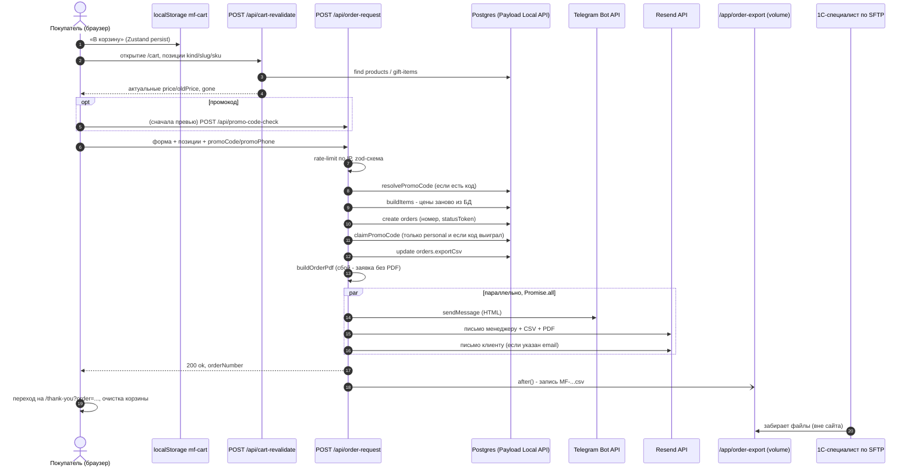

# 04. Путь заказа: от кнопки «В корзину» до всех получателей

- **Для кого:** разработчик, который будет чинить или менять оформление заказа; технический администратор, разбирающий «заказ есть, а уведомления нет».
- **Что здесь:** каждый шаг заявки — файл, вход, выход, что происходит при сбое; промокоды; rate-limit; статусы и страница статуса; CSV/PDF; куда заказ физически попадает.

Связанные документы: [03-data-model.md](03-data-model.md) (коллекция `Orders`, `PromoCodes`), [08-infrastructure.md](08-infrastructure.md) (переменные окружения, volume `order-export`), [09-operations.md](09-operations.md) (инциденты «письма не приходят», «Telegram молчит»).

---

## 1. Общая картина

Оплаты онлайн нет: «заказ» — это **заявка**, которую менеджер обрабатывает вручную. Главный принцип, заложенный в код: **заявка считается принятой, как только она записана в базу**. Всё, что после (CSV, PDF, Telegram, письма, файл для 1С), — второстепенные каналы: их сбой пишется в лог и не превращает успешный ответ клиенту в ошибку (`src/app/(frontend)/api/order-request/route.ts`, комментарий в начале файла).

> **Особенности.** Telegram и оба письма отправляются до ответа покупателю (`await notifyOrder(...)` в `route.ts`); через `after()` после ответа выполняется только запись CSV-файла для 1С. Время ответа формы включает время ответа Resend/Telegram; сбой канала ответ не ломает: у каждого канала свой `try/catch`, ошибка становится строкой в логе.

---

## 2. Шаг за шагом

### 2.1. Корзина (только браузер)

| | |
|---|---|
| Файл | `src/lib/cart/store.ts` (`useCart`, ключ localStorage `mf-cart`), `src/lib/orders/promoStore.ts` (`usePromo`, **не** персистится) |
| Вход | клик «В корзину» на странице товара (`src/components/product/BuyBlock.tsx`) или подарка (`src/components/giftItems/GiftBuyBlock.tsx`) |
| Выход | позиция `{ key, kind, productId, slug, title, brandTitle, sku, volume?, price, oldPrice?, image?, qty }`; ключ — `kind:productId:sku` |
| Сбой | нет серверной части; цена в позиции — снимок на момент добавления и может устареть (см. 2.2) |

Корзина живёт только в браузере покупателя: в базе её нет, менеджер её не видит, пока не отправлена заявка. Промокод хранится отдельно и в памяти вкладки — после перезагрузки страницы его нужно ввести заново (это сделано намеренно: сервер всё равно перепроверит код).

### 2.2. Сверка цен при открытии корзины — `/api/cart-revalidate`

| | |
|---|---|
| Файл | `src/app/(frontend)/api/cart-revalidate/route.ts`, вызывается из `src/components/cart/CartView.tsx` |
| Вход | `POST { items: [{ key, kind?, slug, sku }] }`, до 100 позиций (zod) |
| Выход | `{ ok, items: [{ key, price, oldPrice, gone? }] }`; `useCart.sync()` обновляет цены, удаляет пропавшие позиции и подсвечивает изменившиеся |
| Сбой | 400 на кривой JSON/схему; лимита запросов нет намеренно (чтение без побочных эффектов) |

Зачем: чтобы сумма в корзине совпадала с той, которую сервер посчитает при оформлении. Условия «позиция больше не заказуема» здесь те же, что в `buildItems` (вариант выключен, товар пропал). Это **не** источник истины для денег — только способ показать покупателю то же, что посчитает сервер.

### 2.3. Промокод в корзине — `/api/promo-code-check` (превью)

| | |
|---|---|
| Файл | `src/app/(frontend)/api/promo-code-check/route.ts` → `resolvePromoCode()` в `src/lib/orders/promo.ts`; UI — `src/components/cart/PromoCodeInput.tsx` |
| Вход | `POST { code, phone? }` |
| Выход | `{ ok: true, code, percent, codeType }` или `{ ok: false, error }`, где `error` ∈ `not_found` / `inactive` / `used` / `expired` / `phone_required` / `phone_mismatch` |
| Статусы | `phone_required` → 200 (это шаг, а не отказ), `phone_mismatch` → 400, остальные отказы → 404 |
| Лимит | **нет** — проверка двухшаговая (код, затем телефон), и лимит показывал бы «слишком много попыток» вместо настоящей причины отказа |

Ничего не пишет в базу и не «гасит» код. Сумму скидки корзина считает сама по правилу `priceLine` (см. 2.6).

### 2.4. Отправка формы — `src/components/cart/OrderForm.tsx`

Форма шлёт `POST /api/order-request`. На ответ `promo_invalid` сбрасывает промокод в сторе; при успехе — `router.push('/thank-you?order=<номер>')`. Корзину очищает **не форма**, а страница «Спасибо» (`src/app/(frontend)/[locale]/thank-you/LeadEvent.tsx`) — чтобы не мигала «пустая корзина» между отправкой и переходом.

### 2.5. Приём заявки — `POST /api/order-request`

Файл: `src/app/(frontend)/api/order-request/route.ts`. Путь **не** `/api/orders`: этот адрес принадлежит REST-API Payload, и статический роут Next перекрыл бы его — админка перестала бы читать заявки.

Порядок внутри обработчика (не менять без причины):

| # | Шаг | Где | Ответ при отказе | Логируется? |
|---|---|---|---|---|
| 1 | Rate-limit по IP (scope `default`) | `checkRateLimit(ip)` из `src/lib/orders/rateLimit.ts` | 429 `rate_limit` + `Retry-After` | нет |
| 2 | Разбор JSON | — | 400 `bad_json` | нет |
| 3 | Валидация zod `orderRequestSchema` | `src/lib/orders/schema.ts` | 400 `validation` + список полей | нет |
| 4 | Промокод (если передан) | `resolvePromoCode(payload, code, promoPhone)` | 400 `promo_invalid` + `promoError` | нет |
| 5 | Честная переоценка позиций | `buildItems()` в том же файле | 400 `items_unavailable`, если не осталось ни одной позиции | нет |
| 6 | Создание заказа | `payload.create({ collection: 'orders', ... })` | исключение → 500 (заявки нет) | стандартный лог Next/Payload |
| 7 | Погашение одноразового кода | `claimPromoCode()` | не влияет на ответ | `warn` при гонке |
| 8 | CSV в поле заказа | `buildOrderCsv()` → `payload.update({ exportCsv })` | исключение → 500, **но заказ уже в БД** | стандартный |
| 9 | Файл для 1С | `after(() => writeOrderCsvExport(order, csv))` | не влияет (после ответа) | `console.error` |
| 10 | PDF | `buildOrderPdf()` | не влияет, письмо уйдёт без PDF | `payload.logger.error` |
| 11 | Уведомления | `notifyOrder()` → `logNotifyReport()` | не влияет | `info`/`error` по каждому каналу |
| 12 | Ответ | `{ ok: true, orderNumber, dryRun }` | — | — |

**Валидация (шаг 3)** — `orderRequestSchema`:

| Поле | Правило |
|---|---|
| `name` | строка, после trim ≥ 2 символов |
| `phone` | нормализуется `normalizePhone` к виду `+373XXXXXXXX`, затем `PHONE_PATTERN = /^\+373\d{8}$/` (`src/lib/orders/phone.ts`). Обязателен всегда, в том числе в режиме «без звонка» |
| `email` | пусто или валидный email; необязателен |
| `messenger` | `telegram` / `viber` / `whatsapp` / `call`, необязательно |
| `checkoutMode` | `standard` (по умолчанию) / `noCall` |
| `deliveryMethod` | `pickup` (по умолчанию) / `delivery` |
| `paymentMethod` | `cash` (по умолчанию) / `card` — это отметка, не онлайн-оплата |
| `address` | до 500 символов; **обязателен только при `delivery`** (`.refine`) |
| `comment` | до 2000 символов |
| `locale` | `ro` / `ru` / `en`, по умолчанию `ro` |
| `items` | ≥ 1 позиции; `kind` (`product`/`gift`), `slug`, `sku`, `qty` 1–99; `price`/`title` из тела **не используются** для денег |
| `promoCode`, `promoPhone` | необязательны, до 50 / 40 символов |
| `company` | honeypot: поле скрыто от человека, должно быть пустым; бот получает обычную `validation` |

Те же правила обязательности адреса продублированы в самой коллекции (`validate` у `customer.address` в `src/collections/Orders.ts`) — чтобы ручное создание заказа в админке их тоже соблюдало.

**Честная переоценка (шаг 5) — `buildItems()`.** Для каждой присланной позиции сервер заново ищет документ по `slug` и вариант по `sku`:

- `kind: 'product'` → коллекция `products` (с `depth: 1`, чтобы взять название бренда). Позиция молча выбрасывается, если товара нет или вариант `isActive === false`. **Остаток (`stock`) не проверяется** и не резервируется — заказ на распроданный вариант принимается; наличие подтверждает менеджер.
- `kind: 'gift'` → коллекция `gift-items`; выбрасывается, если сам подарок или номинал неактивны. Промокод к подаркам **не применяется** никогда.
- Из тела запроса берутся только «что» (`slug`, `sku`, `qty`). Цена, название, бренд, объём — из базы. Подменить цену запросом невозможно.
- Для каждой товарной позиции считается `priceLine(variant.price, variant.oldPrice, promoPercent)` — см. ниже. В позицию заказа кладётся снимок: `price` (за штуку уже со скидкой), `lineTotal`, а если скидка была — `basePrice`, `discountPercent`, `discountSource` (`product` или `promo`).

### 2.6. Расчёт скидки — `src/lib/pricing.ts`

Правило совмещения: **на каждой позиции выигрывает больший процент — собственная скидка товара или промокод; скидки не складываются и не перемножаются.**

- `discountPercent(price, oldPrice)` = `round((1 − price/oldPrice) × 100)`, только если `oldPrice > price`.
- `priceLine()`:
  - если процент промокода **строго больше** процента товара → цена = `round(base × (100 − promo) / 100)`, где `base` — `oldPrice`, если скидка у товара реальна, иначе `price`; источник `promo`;
  - иначе → цена = сохранённая `price` как есть (не пересчитывается из процента, чтобы округление не меняло цену на ±несколько MDL); источник `product` или `null`.
- При равенстве процентов выигрывает товар — промокод не тратится впустую.
- Итог заказа `total` = сумма `lineTotal` (отдельного вычитания на уровне заказа нет).
- `promoDiscountPercent` в заказе — **номинал** кода; `promoDiscountAmount` — фактическая выгода именно от кода по позициям, где он выиграл.

### 2.7. Создание заказа (шаг 6) и хук номера

`payload.create` выполняется через Local API — проверки доступа коллекции (`create: staffOnly`) при этом не действуют (Local API по умолчанию работает с `overrideAccess`). Снаружи через REST создать заказ анониму нельзя.

Хук `beforeChange` в `src/collections/Orders.ts` при создании проставляет:

- `orderNumber` = `MF-<ГГММДД>-<4 символа base36>`, например формата `MF-261001-XXXX` (поле `unique`);
- `statusToken` = 24 случайных байта в hex (`crypto.randomBytes`) — ключ публичной страницы статуса;
- `status` по умолчанию `new`.

### 2.8. Промокоды: погашение (шаг 7)

Два типа (`src/collections/PromoCodes.ts`, `src/lib/orders/promo.ts`):

| | `personal` (из попапа) | `public` (для соцсетей) |
|---|---|---|
| Кто создаёт | бэкенд, `POST /api/promo-popup` | админ в `/admin` |
| Формат | `WELCOME-XXXXXX` (алфавит без 0/O/1/I/L) | любой, хранится в верхнем регистре |
| Применений | одно (`isUsed`) | без ограничения |
| Срок | не проверяется | `expiresAt` обязателен; пустой = считается просроченным |
| Привязка | email (один код на email) + телефон | нет |
| Проверка телефона | да: `promoPhone` сверяется с `phone` кода после нормализации; пустой телефон в записи кода = сверка пропускается | нет |

Погашение: только для `personal` и **только если код реально выиграл хотя бы на одной позиции** (`promoWonAnywhere`). Код, который нигде не дал выгоды (у всех товаров своя скидка больше), остаётся неиспользованным. Погашение — один атомарный `UPDATE ... WHERE id = ? AND isUsed = false` через `payload.update({ where })` (`claimPromoCode`). Если два заказа одновременно применили один код, второй заказ всё равно создаётся со скидкой, а в лог пишется `warn` «не удалось пометить использованным (гонка?)». Окно гонки сознательно не закрыто: код гасится **после** создания заказа, чтобы передумавший покупатель не «сжёг» его.

**Попап «первая скидка» — `POST /api/promo-popup`** (`src/app/(frontend)/api/promo-popup/route.ts`, UI `src/components/promo/PromoPopupClient.tsx`):

1. Rate-limit, scope `promo-popup`.
2. Глобал `promo-popup-settings`: если `isEnabled` выключен → 403 `disabled` (выключенный попап не раздаёт коды даже прямым запросом). Если `requirePhone` включён — телефон обязателен; заполненный телефон проверяется тем же `PHONE_PATTERN`.
3. Если на этот email код уже выдавался — возвращается **тот же** код (`existing: true`, в том числе использованный), письмо повторно не шлётся (защита чужого ящика от «бомбардировки»).
4. Иначе генерируется уникальный `WELCOME-…`, процент берётся из `discountPercent` глобала (не из запроса), создаётся `promo-codes` типа `personal`.
5. Письмо с кодом уходит через `after()` (`sendPromoCodeEmail`) — после ответа; код покупатель уже видит на экране, письмо — дубль.

Попап показывается один раз на браузер: флаг в `localStorage` (ключ `mf-promo-popup-seen`, см. `PromoPopupClient.tsx`), через ~2 с после загрузки любой страницы витрины.

### 2.9. CSV заявки (шаг 8) — `src/lib/orders/csv.ts`

- Формат «под Excel»: разделитель `;`, кодировка UTF-8 с BOM, переводы строк `\r\n`. Подписи значений — по-русски.
- Колонки (`CSV_COLUMNS`): `date; name; phone; messenger; checkoutMode; deliveryMethod; paymentMethod; address; product; brand; volume; sku; qty; price; sum; promoCode; discount; comment`.
- Одна строка = одна позиция, шапка заказа повторяется в каждой строке; последняя строка — `ИТОГО` с `sum` = `total`, `promoCode` и `discount` = `promoDiscountAmount`.
- `checkoutMode` пишется как пусто (обычная) или `БЕЗ ЗВОНКА`.
- Имя файла — `<orderNumber>.csv`.
- Сохраняется текстом в поле заказа `exportCsv` — из него кнопка «CSV» в админке отдаёт файл без обращения к серверу. Массовый CSV по выделенным заявкам — эндпоинт `GET /api/orders/bulk-csv` (только admin/manager).

Тот же CSV уходит и в письмо, и в папку для 1С.

### 2.10. Файл для 1С (шаг 9) — `src/lib/orders/orderExport.ts`

- Пишет `<orderNumber>.csv` в каталог `ORDER_EXPORT_DIR` (по умолчанию `/app/order-export`), создавая его при необходимости. Повторная запись с тем же номером перезаписывает файл.
- Вызывается через `after()` — после отправки ответа клиенту; любая ошибка (нет volume, нет места, нет прав) — только `console.error` с номером заказа.
- На сервере Coolify монтирует каталог хоста `/opt/order-export/files` в контейнер как `/app/order-export`; системный пользователь хоста для SFTP заперт `ChrootDirectory` в `/opt/order-export` и видит только `files/`. Сайт файлы **не удаляет** — забранные файлы удаляет сторона 1С или администратор сервера.
- Права на этот каталог чинит `docker-entrypoint.sh` при каждом старте (тот же приём, что для `/app/media`).

### 2.11. PDF (шаг 10) — `src/lib/orders/pdf.ts`

- Библиотека `pdf-lib` + `@pdf-lib/fontkit` (чистый JS, совместима со standalone-сборкой).
- A4, язык **всегда русский** (читатель — менеджер). Шапка «MON FLACON» и «ЗАЯВКА <номер>»; блоки клиента/доставки; заметная плашка «НЕ ЗВОНИТЬ — клиент просил не звонить» при `noCall`; таблица позиций (Бренд, Наименование, Объём, Артикул, Кол-во, Цена, Сумма); строка промокода и, если телефон кода отличается от телефона заявки, — отдельной строкой телефон кода (`resolveOrderPromoPhone` берёт его из записи промокода); `ИТОГО`; колонтитул.
- Шрифты: `src/lib/orders/fonts/Inter-Regular.ttf`, `Inter-SemiBold.ttf` (OFL). Ищутся по списку `FONT_DIR_CANDIDATES`: `ORDER_PDF_FONT_DIR` → `<cwd>/src/lib/orders/fonts` → `<cwd>/.next/standalone/src/lib/orders/fonts`. В образ они попадают двумя путями: Dockerfile копирует `src/` целиком, а `next.config.ts` (`outputFileTracingIncludes`) кладёт их в standalone.
- Сбой генерации → письмо уходит только с CSV, ошибка `[order …] pdf failed` в логе.
- В админке PDF не хранится: кнопка «PDF» вызывает `GET /api/orders/:id/pdf` (аноним — 401, не-сотрудник — 403).

### 2.12. Уведомления (шаг 11) — `src/lib/orders/notify.ts`

`notifyOrder()` запускает три канала **параллельно** (`Promise.all`); каждый возвращает `{ ok, skipped?, error? }` и сам ловит свои исключения.

| Канал | Файл | Условие отправки | Пропуск («skipped») | Содержимое |
|---|---|---|---|---|
| Telegram | `src/lib/orders/telegram.ts` | `TELEGRAM_BOT_TOKEN` и `TELEGRAM_CHAT_ID` заданы и не `CHANGEME…` | нет токена/чата | HTML: номер, позиции (бренд, название, объём, sku, кол-во × цена = сумма), промокод, итог, имя, телефон, мессенджер, способ получения/оплаты, адрес (если есть), комментарий, жирная строка «БЕЗ ЗВОНКА — НЕ ЗВОНИТЬ», язык и источник |
| Письмо менеджеру | `src/lib/orders/email.ts` → `sendEmail` | `RESEND_API_KEY` и `ORDER_EMAIL_TO` заданы | нет ключа или получателя | тема «Новая заявка <номер> — <сумма> MDL[ — БЕЗ ЗВОНКА]», HTML-таблица позиций, вложения CSV и (если удалось) PDF |
| Письмо клиенту | `email.ts` → `sendCustomerEmail` | ключ задан и клиент указал email | нет ключа или email | на языке заявки (`messages/*.json`, namespace `OrderEmailCustomer`), состав, итог, ссылка на `/<locale>/order/<statusToken>`; без вложений |

Отправитель писем — `ORDER_EMAIL_FROM`, а если не задан — тестовый адрес Resend `MON FLACON <onboarding@resend.dev>` (зашит в `email.ts`). Боевая отправка рассчитана на адрес верифицированного в Resend домена. Ссылка на статус строится от `NEXT_PUBLIC_SERVER_URL`.

`logNotifyReport()` пишет по строке на канал: `[order MF-…] telegram sent` / `… skipped (…)` / ошибку с кодом ответа API (первые 200 символов тела). Это след каждой отправки в логе; очереди и повторной отправки нет.

**`ORDERS_DRY_RUN=1`** глушит все три канала (`skipped (ORDERS_DRY_RUN=1)`), но заказ, CSV в БД, PDF и файл для 1С создаются как обычно. Ответ формы содержит `dryRun: true`. На проде должно быть `0`.

### 2.13. Страница «Спасибо» и страница статуса

- `/[locale]/thank-you?order=<номер>` (`src/app/(frontend)/[locale]/thank-you/page.tsx`) — страница подтверждения после отправки формы: итог заявки и ссылка на страницу статуса. Страница `noindex`.
- `/[locale]/order/<statusToken>` (`.../order/[token]/page.tsx`) — публичная страница статуса по неугадываемому токену; `notFound()` при неверном токене; `noindex`.
- `/[locale]/order` — форма «найти заказ» (`OrderLookupForm.tsx`) → `POST /api/order-status` (`src/app/(frontend)/api/order-status/route.ts`): **номер и телефон обязательны оба** (`orderLookupSchema`), отдаётся только токен; при несовпадении одна и та же ошибка 404 `not_found`, чтобы перебором нельзя было подтвердить существование номера. Rate-limit, scope `order-status`. Ссылка «Отследить заказ» в футере выведена вне CMS-циклов, чтобы не зависеть от содержимого меню.

### 2.14. Статусы заказа

Заданы в `ORDER_STATUSES` (`src/collections/Orders.ts`); публичные подписи — `messages/*.json`, namespace `OrderStatus`.

| Значение | В админке | Смысл |
|---|---|---|
| `new` | Новая | создана формой (по умолчанию) |
| `confirmed` | Подтверждена | менеджер связался |
| `ready` | Готова | собрана, ждёт выдачи |
| `issued` | Выдана | получена клиентом |
| `cancelled` | Отменена | |

Статус меняет только человек в админке; автоматических переходов, уведомлений клиенту о смене статуса и связи статуса с остатками нет. Дашборд админки показывает карточку «Новых заявок» (`src/components/admin/NewOrdersCard.tsx`).

---

## 3. Rate-limit

Файл: `src/lib/orders/rateLimit.ts`.

| Эндпоинт | scope | Лимит |
|---|---|---|
| `POST /api/order-request` | `default` | `ORDERS_RATE_LIMIT` (по умолчанию 5) за 10 минут на IP |
| `POST /api/order-status` | `order-status` | то же число, отдельный счётчик |
| `POST /api/promo-popup` | `promo-popup` | то же число, отдельный счётчик |
| `POST /api/promo-code-check` | — | без лимита |
| `POST /api/cart-revalidate` | — | без лимита |

- Счётчик — `Map` **в памяти процесса Node**. Сбрасывается при каждом рестарте/деплое контейнера. При двух и более репликах у каждой был бы свой счётчик (фактический лимит умножается на число реплик) — тогда счётчик нужно переносить в Redis/БД. Реплика одна.
- IP берётся из `cf-connecting-ip`, затем первого адреса `x-forwarded-for`, затем `x-real-ip`, иначе `unknown` (все «неизвестные» делят один счётчик). Схема рассчитана на то, что весь трафик идёт через Cloudflare.
- Лимит одинаков для всех трёх scope — отдельной переменной на каждый нет.
- При тестах лимит поднимают на время прогона (`ORDERS_RATE_LIMIT=30`), см. [10-tests-and-tools.md](10-tests-and-tools.md).

---

## 4. Где заказ оказывается физически

| Место | Что лежит | Когда появляется | Кто видит | Если не появилось |
|---|---|---|---|---|
| Postgres, таблица `orders` (+ `orders_items`) | весь заказ: клиент, позиции-снимки, суммы, промокод, `statusToken`, `exportCsv` | синхронно, шаг 6 | admin и manager в `/admin` | заявки нет вообще — клиент получил ошибку |
| Postgres, `promo-codes` | `isUsed=true`, `usedInOrder` | синхронно, шаг 7 | admin/manager | `warn` в логе, заказ есть |
| Telegram-чат менеджера | текст заявки | синхронно, до ответа | участники чата | строка `telegram …` в логе контейнера |
| Почта `ORDER_EMAIL_TO` | письмо + CSV + PDF | синхронно, до ответа | менеджер | строка `email`/`resend …` в логе |
| Почта клиента | подтверждение со ссылкой на статус | синхронно, если указан email | клиент | строка `customer-email …` в логе |
| `/app/order-export/<номер>.csv` в контейнере = `/opt/order-export/files` на хосте | тот же CSV | в фоне после ответа | 1С-специалист по SFTP | `order-export csv write failed` в логе |
| Админка | список, карточка, кнопки CSV/PDF, массовый CSV | сразу | admin/manager | — |
| Резервная копия БД (Backblaze B2) | дамп со всеми заказами | ежедневно | администратор | см. [09-operations.md](09-operations.md) |

---

## 5. Что легко сломать при изменениях

- Новый вид позиции в корзине — расширять дискриминатор `kind` (как сделано для подарков), а не заводить второй стор; проверить шаблоны вида `${item.volume ?? ''} ml` (у подарков объёма нет).
- Новое поле заявки должно появиться в: `schema.ts`, `Orders.ts` (+ миграция), `telegram.ts`, `email.ts`, `csv.ts` (фиксированная шапка), `summary.ts`/`pdf.ts`, при необходимости колонка в админке. Пометка «не звонить» — образец поля, которое проведено через все каналы.
- Любой новый роут с `after()`, тестируемый прямым вызовом `POST()`, требует мока `next/server` в тесте (`tests/int/order-promo-burn.int.spec.ts`).
- Не называть новые роуты `/api/<slug-коллекции>`.
