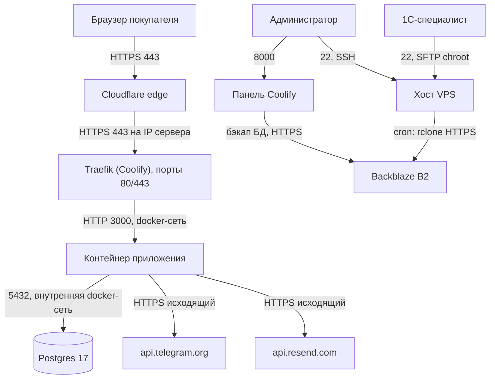
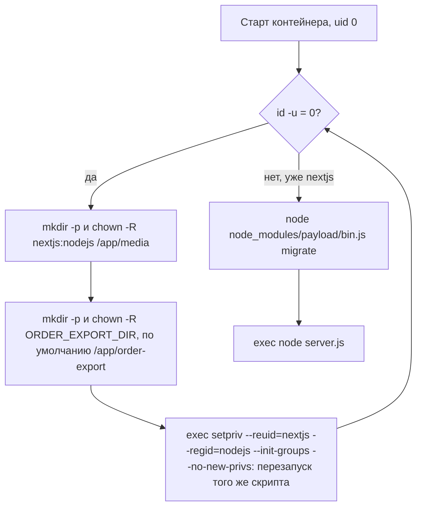

# 08. Инфраструктура и окружение

- **Для кого:** тот, кто будет деплоить, переезжать на другой сервер, менять ключи или разбираться с сетью.
- **Что здесь:** что где живёт (VPS, Coolify, Postgres, Cloudflare, домен, Resend, Telegram, Backblaze B2, SFTP для 1С); схема сети; Dockerfile и порядок старта контейнера; volume и монтирования; полный реестр переменных окружения; ветки и схема деплоя; архитектурные ограничения.

**Значений секретов, паролей, IP-адресов и идентификаторов в этом документе нет намеренно.** Где хранятся сами значения: переменные приложения — в Coolify (Environment Variables приложения); секреты бэкапа — в файле на хосте; полный комплект секретов — в хранилище секретов администратора, вне репозитория.

---

## 1. Что где живёт

| Компонент | Где | Что важно знать |
|---|---|---|
| VPS | хостинг TopHost.md, тариф VPS3 Unmanaged (4 ядра / 8 ГБ / 75 ГБ NVMe), Ubuntu 24.04 LTS | фактический IP сверять командой `ip -4 addr show` на сервере. Сервер живёт в UTC. Если после `reboot` сервер не поднялся — кнопка Start в панели хостера |
| Защита сервера | `ufw` (22/80/443/8000), `fail2ban`, `unattended-upgrades`, swap 2 ГБ, SSH-ключ | настройки `sshd` — на хосте |
| Coolify | установлен на тот же VPS, панель на порту 8000 | собирает образ из GitHub по Dockerfile, держит контейнер приложения, Postgres, домены/SSL (Traefik), бэкапы БД. Свой `.env` панели (секреты Coolify) лежит на сервере в каталоге данных Coolify |
| Приложение | ресурс Coolify «Public Git Repository», Build strategy: Dockerfile, ветка `phase_8.0`, порт 3000 | один контейнер; реплика одна |
| Postgres | отдельный сервис Coolify, версия 17, **Private** (наружу не открыт) | приложение подключается по внутреннему Docker-адресу (`DATABASE_URI`) |
| Медиа | persistent volume Coolify → `/app/media` в контейнере | фото товаров, логотипы, баннеры; S3/R2 не подключён |
| Экспорт для 1С | каталог хоста `/opt/order-export/files` → `/app/order-export` в контейнере (Directory mount в Persistent Storage Coolify) | системный пользователь хоста `order-export`, группа `sftpusers`, `nologin`, `ChrootDirectory /opt/order-export` (блок `Match Group sftpusers` в `sshd_config`) — видит только `files/` |
| Домен | `monflacon.md`, зарегистрирован у TopHost | NS переведены на Cloudflare |
| Cloudflare | Free-план: DNS, две A-записи (корень и `www`), режим Proxied | R2 не используется. Почтовые записи Resend — **DNS only** (серое облако). Лимит загрузки ~100 МБ на запрос (Free) — упирается ZIP-импорт |
| Resend | домен `monflacon.md` верифицирован (регион Ireland), записи DKIM/SPF/MX `send`/DMARC в Cloudflare; API-ключ с правом Sending | лимиты отправки — по тарифу Resend |
| Telegram | бот и чат менеджера, токен и chat id — в переменных Coolify | |
| Backblaze B2 | бакет для бэкапов, регион eu-central, Private, шифрование включено, версионирование «Keep all versions», Object Lock выключен; ключ приложения — только на этот бакет | удаление без `hard_delete=true` не освобождает место |
| GitHub | репозиторий **публичный**, `.env` в `.gitignore` | основная копия кода |
| GA4, Search Console | подключаются отдельно | код GA4 есть, включение — [09](09-operations.md) |

---

## 2. Сеть и порты

Открытые наружу порты (по `ufw`): 22, 80, 443, 8000. Панель Coolify (8000) доступна напрямую, мимо Cloudflare. Postgres наружу не открыт.

Rate-limit приложения определяет IP по заголовку `cf-connecting-ip` (`src/lib/orders/rateLimit.ts`), то есть рассчитан на трафик через Cloudflare.

---

## 3. Сборка образа — `Dockerfile`

Базовый образ `node:22-bookworm-slim`, `corepack enable`. Стадии:

| Стадия | Что делает | Зачем |
|---|---|---|
| `deps` | `pnpm install --frozen-lockfile` (прод + dev) | для сборки |
| `prod-deps` | `pnpm install --prod --frozen-lockfile` | полный прод-набор `node_modules` — нужен CLI `payload` для миграций, которого нет в standalone-срезе |
| `build` | `pnpm run build` (`next build`, `output: 'standalone'`, `NODE_OPTIONS=--max-old-space-size=8000`) | сборка без доступа к БД: `generateStaticParams` и `sitemap` обёрнуты в `staticParamsOrEmpty` |
| `runner` | `NODE_ENV=production`, `PAYLOAD_CONFIG_PATH=/app/src/payload.config.ts`, пользователь `nextjs` (uid 1001) / группа `nodejs` (gid 1001); копирует `public`, `.next/standalone`, `.next/static`, `node_modules` из `prod-deps`, **`src/` целиком**, `tsconfig.json`, `scripts/`, `docker-entrypoint.sh`; `EXPOSE 3000`, `PORT=3000`, `HOSTNAME=0.0.0.0` | `src/` нужен CLI миграций и шрифтам PDF; `scripts/` — для ручного запуска импорта/скриптов внутри контейнера |

`USER nextjs` в Dockerfile **намеренно отсутствует** — см. следующий раздел. `docs/`, `tests/`, `media/`, `.env` в образ не попадают (`.dockerignore`).

Внутри прод-контейнера `pnpm <script>` не работает (у `nextjs` нет домашнего каталога, corepack не может закэшировать pnpm). Скрипты запускаются напрямую: `./node_modules/.bin/tsx scripts/<файл>.ts`.

---

## 4. Старт контейнера — `docker-entrypoint.sh`

Почему именно так:

1. **Root в начале.** Coolify монтирует volume в `/app/media` (и каталог экспорта) при старте контейнера, уже после сборки образа; точка монтирования принадлежит `root`. `chown` в Dockerfile этого не исправляет. Без починки прав любая загрузка файла в Media падает `EACCES`.
2. **Сразу сброс привилегий.** `setpriv` делает `execve` в том же PID — сигналы и код выхода проходят как обычно; само приложение под root не работает ни секунды.
3. **Миграции до старта сервера.** Payload не создаёт схему сам (`push: false`); без миграций контейнер поднимется на пустой БД с ошибкой `relation … does not exist`. Миграции идемпотентны — на каждом старте применяются только новые. Если миграция падает, `set -e` останавливает скрипт и сервер не стартует (контейнер упадёт — это видно в логах деплоя).
4. **Сид не запускается** никогда — чтобы не затереть прод-данные.

Следствие: старт контейнера занимает дольше обычного (миграции + запуск последовательно).

---

## 5. Тома и монтирования

| В контейнере | На хосте | Что | Бэкап |
|---|---|---|---|
| `/app/media` | Docker volume, управляется Coolify (путь находится через `docker inspect`) | все загруженные файлы Media | `scripts/backup-media.sh` по cron → архив локально + B2 |
| `/app/order-export` (`ORDER_EXPORT_DIR`) | `/opt/order-export/files` | CSV-файлы заявок для 1С | не бэкапится отдельно (данные есть в БД) |
| `/app/.next/cache` | внутри контейнера, не volume | кэш данных витрины | не нужен |
| данные Postgres | volume сервиса Postgres в Coolify | вся БД | бэкапы Coolify → B2 |

---

## 6. Реестр переменных окружения

Получен grep-ом `process.env.*` по `src/`, `scripts/`, `tests/`, конфигам, плюс `Dockerfile`, `docker-entrypoint.sh`, `scripts/backup-media.sh`. «Когда читается»: **сборка** — значение вшивается в код при `next build` (все `NEXT_PUBLIC_*`; изменение требует полного Redeploy, рестарта мало); **рантайм** — читается при работе, достаточно перезапуска контейнера; **старт процесса** — читается один раз при загрузке модуля.

### 6.1. Приложение (задаются в Coolify)

| Переменная | Назначение | Обязательна | Где в коде | Когда | Без неё |
|---|---|---|---|---|---|
| `DATABASE_URI` | строка подключения к Postgres | **да** | `src/payload.config.ts`, `src/lib/catalog/staticParams.ts`, `scripts/seed-pages-only.ts`, `scripts/set-settings-contacts.ts` | рантайм (на сборке может отсутствовать) | приложение не работает; на сборке `staticParamsOrEmpty` возвращает пустые списки |
| `PAYLOAD_SECRET` | подпись сессий/JWT Payload | **да** | `src/payload.config.ts`, `staticParams.ts` | рантайм | Payload падает «missing secret key»; смена значения разлогинит всех |
| `NEXT_PUBLIC_SERVER_URL` | абсолютный адрес сайта: canonical, hreflang, sitemap, OG, `metadataBase`, ссылка на статус заказа в письме клиенту | **да** для прода | `src/lib/seo/config.ts` (`SITE_URL`), `src/lib/orders/email.ts` | сборка (+ рантайм в серверном коде; в Coolify должна быть доступна на этапе сборки) | все абсолютные ссылки ведут на `http://localhost:3000` |
| `TELEGRAM_BOT_TOKEN`, `TELEGRAM_CHAT_ID` | уведомление о заявке в Telegram | нет | `src/lib/orders/telegram.ts` | рантайм | канал пропускается (`telegram skipped`) |
| `RESEND_API_KEY` | отправка писем через Resend | нет | `src/lib/orders/email.ts` | рантайм | все письма пропускаются (менеджеру, клиенту, с промокодом) |
| `ORDER_EMAIL_TO` | адрес менеджера для писем о заявках | нет | `email.ts` | рантайм | письмо менеджеру пропускается |
| `ORDER_EMAIL_FROM` | отправитель писем | нет (но нужен для боевой отправки) | `email.ts` | рантайм | отправитель — тестовый адрес Resend `onboarding@resend.dev` |
| `ORDERS_DRY_RUN` | `1` — глушит Telegram и письма о заявках | нет | `src/lib/orders/notify.ts` | рантайм | если не `1` — уведомления уходят. На проде `0` |
| `ORDERS_RATE_LIMIT` | лимит запросов с IP за 10 минут для форм заявки, поиска заказа и попапа | нет (по умолчанию 5) | `src/lib/orders/rateLimit.ts` | старт процесса | 5 |
| `ORDER_EXPORT_DIR` | каталог для CSV-файлов заявок (1С) | нет (по умолчанию `/app/order-export`) | `src/lib/orders/orderExport.ts`, `docker-entrypoint.sh` | рантайм / старт контейнера | используется `/app/order-export` |
| `MAINTENANCE_MODE` | `1` — сайт закрыт заглушкой | нет | `src/lib/maintenance.ts` | рантайм (мидлварь) | сайт открыт |
| `MAINTENANCE_BYPASS_TOKEN` | секрет ссылки `?preview=` для входа при заглушке | только при `MAINTENANCE_MODE=1` | `src/lib/maintenance.ts` | рантайм | при включённой заглушке — не войти никому + предупреждение в логе |
| `NEXT_PUBLIC_SOCIAL_INSTAGRAM`, `NEXT_PUBLIC_SOCIAL_TIKTOK` | кнопки соцсетей **только на заглушке** | нет | `src/components/maintenance/MaintenanceSocial.tsx` | сборка | кнопки нет. В футере сайта эти переменные не используются |
| `NEXT_PUBLIC_GA_ID` | Measurement ID GA4 | нет | `src/lib/analytics/gtag.ts` | сборка | GA и баннер согласия не показываются |
| `ORDER_PDF_FONT_DIR` | альтернативный каталог шрифтов PDF | нет | `src/lib/orders/pdf.ts` | рантайм | ищутся в `src/lib/orders/fonts` |
| `IMPORT_LOCALE` | локаль по умолчанию для CSV-импорта, если не передана явно | нет (по умолчанию `ro`) | `src/lib/import/engine.ts` | рантайм | `ro` |
| `SEED_ADMIN_EMAIL`, `SEED_ADMIN_PASSWORD` | админ, которого создаёт `pnpm seed`; логин e2e-тестов | только для сида/тестов | `scripts/seed.ts`, `tests/e2e/order-request.e2e.spec.ts`, `tests/helpers/heroBanners.ts` | при запуске скрипта | на проде не используются (первый пользователь создан через форму `/admin`) |

### 6.2. Задаются образом (Dockerfile), менять не нужно

`NODE_ENV=production` (флаг `secure` у cookie байпаса в `src/proxy.ts`), `NEXT_TELEMETRY_DISABLED=1`, `PAYLOAD_CONFIG_PATH=/app/src/payload.config.ts` (для CLI миграций), `PORT=3000`, `HOSTNAME=0.0.0.0`.

### 6.3. Только для разработки и скриптов

| Переменная | Где | Зачем |
|---|---|---|
| `DEV_ORIGINS` | `next.config.ts` | дополнительные адреса для dev по локальной сети (`allowedDevOrigins`) |
| `SHOT_BASE` | `scripts/check-*.mjs`, `scripts/shots.mjs` | базовый URL проверок (по умолчанию localhost) |
| `CACHE_CHECK_SLUG`, `PG_CONTAINER` | `scripts/check-cache.mjs` | товар и docker-контейнер Postgres для замера кэша |
| `LOAD_COUNT` | `scripts/seed-load.ts` | число синтетических товаров |
| `CI` | `playwright.config.ts` | `forbidOnly`, ретраи |

### 6.4. Переменные, которые код не читает

`S3_*` и `SENTRY_DSN` приложением не используются: адаптер внешнего хранилища не подключён (`plugins: []` в `payload.config.ts`), медиа хранятся на диске VPS; Sentry не установлен. В Coolify их задавать не нужно.

### 6.5. Бэкап медиа на хосте (не в Coolify)

Файл `/etc/monflacon-backup.env` (права 600), читается `scripts/backup-media.sh` (путь можно переопределить `ENV_FILE`): `B2_REMOTE_PATH`, `B2_KEY_ID`, `B2_APP_KEY`, `RETENTION`, `RETENTION_REMOTE`; необязательные `BACKUP_DIR` (по умолчанию `/opt/backups/media`), `MEDIA_DEST` (`/app/media`), `LOG_FILE`, `LOCK_FILE`. Из них скрипт сам выставляет `RCLONE_CONFIG_B2REMOTE_TYPE/ACCOUNT/KEY/HARD_DELETE` — файла `rclone.conf` на сервере нет намеренно. Шаблон — `scripts/backup-media.env.example`.

---

## 7. Ветки и деплой

- Coolify собирает ветку **`phase_8.0`** из **origin** (GitHub). Ветку в Coolify не переключать.
- `main` не деплоится; рабочие ветки сливаются в `phase_8.0`.
- Слияние локально **ничего не деплоит** — обязательно `git push origin phase_8.0`, проверять по метке `origin/phase_8.0` в `git log --oneline`, а не по `git status`. Не склеивать `git add . && git commit && git push` в одну команду: при пустом коммите `&&` молча не дойдёт до `push`.
- Деплой запускается в Coolify кнопкой Deploy/Redeploy (см. [09](09-operations.md)).

---

## 8. Архитектурные ограничения

- **Один сервер, без staging.** Отдельного тестового окружения нет. Любой деплой сразу идёт на прод; вещи вроде Docker-сборки, автомиграций и специфики Coolify проверяются только реальным деплоем — не деплоить под конец дня.
- **Репозиторий публичный.** Секретов в коде нет; всё секретное — в Coolify и на хосте.
- **Одна реплика**: rate-limit в памяти процесса (сбрасывается при рестарте) и кэш данных на диске контейнера (теряется при пересоздании контейнера, восстанавливается по запросам; TTL 300 с, сброс хуками) рассчитаны на один экземпляр.
- **Медиа — на диске VPS**: переезд на S3 потребует плагина хранилища Payload и миграции файлов.
- **Окно `create-first-user`**: на пустой БД `/admin` предлагает любому создать первого пользователя (он станет админом). При развёртывании с нуля создать его сразу после первого успешного деплоя.
